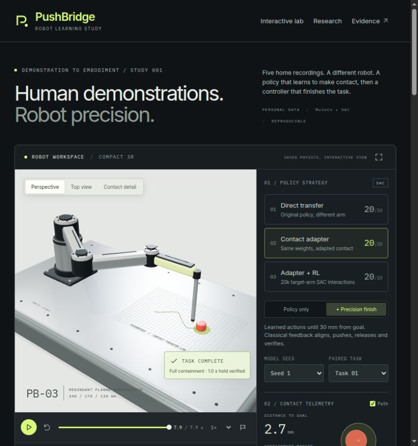

# PushBridge

**From five home videos to contact-aware robot control in MuJoCo.**

A finger pushes a red cap into a drawn circle. This project extracts those motions, uses them to initialize a learned policy, and transfers the policy to a robot with different joints, tool geometry and object dynamics. It also learns object-motion predictions and exports a faster actor.

**Start with the [3D research app](docs/WEB_APP.md), the [two-minute evidence guide](docs/REVIEWER_GUIDE.md), or the [complete experiment details](docs/EXPERIMENTS.md).** The main app uses React, Vite and Three.js. It builds to a static site that can be deployed on Vercel.



## Open the demo

The saved results are included. You can build the app without installing Python or retraining the policies. With Node 22.12 or newer and pnpm available:

```bash
cd web
pnpm install --frozen-lockfile
pnpm dev
# Open the local URL printed by Vite.
```

Select a transfer strategy, switch between policy alone and policy plus feedback, then replay or scrub a task. The 3D arm follows recorded joint angles; the object follows recorded positions. Three.js renders the scene, while MuJoCo produced the underlying physics traces. The browser does not run a new policy rollout.

For a production build, run `pnpm build` and `pnpm preview` from `web/`. See [frontend setup, evidence export and Vercel deployment](docs/WEB_APP.md). The earlier [offline report](index.html) and all experiment reports remain in the repository for direct inspection.

## What is actually learned?

| Component | Input and role |
| --- | --- |
| Personal demonstrations | Five original clips; three train, one validates, one tests. 289 usable transitions. |
| SAC actor | Fingertip actions initialize its mean action; simulator interactions train the robot policy. |
| World model | Personal tracks train an ensemble predicting object displacement from contact and tool actions. |
| Embodiment adapter | Known tool radii transform contact-relative observations and actions. |
| Precision feedback | Explicit classical control handles the last 30 mm, then releases contact. No learned weights. |
| Exported actor | Same policy weights with less inference overhead. |

The robot policy takes **simulator positions**, not images or language. The world model predicts **states**, with future tool actions supplied. This is a state-based robot-learning study, not an end-to-end VLA or generative video model.

## Why the old videos stopped too early

The original success rule was a centre error below 18 mm. The target radius is 20 mm; the puck radius is 12 mm. To fit the entire puck, the centre error must be **at most 20 − 12 = 8 mm**. At 18 mm, the puck can protrude 10 mm outside the target.

The original results remain unchanged. A separate follow-up removes the early stop and requires full containment throughout a one-second stationary hold. The checkpoints are unchanged. An additional comparison adds the same hand-coded precision feedback to each approach policy.

| Compact 3R approach | Policy alone, strict rule | With precision feedback, strict rule |
| --- | --- | --- |
| Direct transfer | 0/20 · 0/20 · 0/20 | **20/20 · 20/20 · 20/20** |
| Contact adapter | 10/20 · 20/20 · 20/20 | **20/20 · 20/20 · 20/20** |
| Adapter + target RL | 6/20 · 19/20 · 16/20 | **20/20 · 20/20 · 19/20** |

Cells list training seeds 0 / 1 / 2 on the same 20 paired cases. They are not 60 independent tasks. Direct and contact-adapted hybrids finish at roughly 2.7 mm mean centre error. The RL hybrid still has one failure; its three-seed mean is 4.5 mm including that failure.

**Control attribution matters.** Feedback alone solves 18/20 under the same 120-decision budget. Some adapted policies already finish when allowed to continue; the finisher improves precision rather than creating every success. On 20 fresh tasks with seed 1 checkpoints, all three hybrids solve 20/20; policy-only direct transfer remains 0/20. [Protocol and all individual outcomes](results/precision_finish/evaluation.json) · [Precision methodology](docs/PRECISION.md)

## Other findings

| Experiment | Result and practical limit |
| --- | --- |
| Personal initialization + SAC | 20/20 for all three source-arm seeds under the original 18 mm rule. Classical control and MPC also solve 20/20. |
| Personal post-training after SAC | Improves one seed and worsens two. Human action labels can conflict with robot behavior. |
| Contact-space transfer | Original compact-arm frozen adapter solves 20/20 for all seeds at 18 mm. More target RL introduces one failure. |
| State world model | 0.89 mm one-step mean error; 7.92 mm at ten steps, on one held-out recording and a chosen simulator scale. |
| Actor inference | Direct Torch median 3.92× faster, with identical actions and states in all 20 tested rollouts. Local CPU result. |

SAC means Soft Actor-Critic, the reinforcement-learning algorithm used here. MPC means Model Predictive Control: score candidate actions using predicted future object motion. [Full metrics, budgets and reproduction commands](docs/EXPERIMENTS.md)

## Install and reproduce

```bash
python3 -m venv .venv
source .venv/bin/activate
python -m pip install -e '.[dev,analysis,rl]'
python -m pytest -q
python scripts/audit_submission.py
python scripts/precision_experiment.py --out results/precision_rerun
```

Run commands from the repository root. New results go to a fresh folder, preserving included evidence. The precision comparison adds no training; it loads the included checkpoints. Full retraining commands are in [EXPERIMENTS.md](docs/EXPERIMENTS.md). `make help` lists common tasks. `make package` produces a CRC-checked ZIP containing the files selected for GitHub, excluding caches and ignored exploratory runs.

Python 3.12 and CPU execution were tested. MuJoCo is pinned to 3.3.7. Linux rendering defaults to EGL; a working OSMesa setup can use `MUJOCO_GL=osmesa`. Windows virtual environments activate via `.venv\Scripts\activate`.

## Repository map

```text
pushbridge/
├── README.md                 # Start here: question, results, setup
├── web/                      # React + Three.js app, lockfile and public evidence
├── index.html                # Earlier offline research report
├── dashboard/                # Earlier UI and complete generated report data
├── src/pushbridge/           # Tracking, models, policies, physics and controllers
├── scripts/                  # Experiments, artifact builders and evidence audit
├── tests/                    # Contact, tracking, kinematics and deployment checks
├── data/raw/personal_circle/ # Five recordings with private metadata removed
├── data/processed/           # Extracted tracks, splits and tracking previews
├── results/                  # Protocols, checkpoints, traces, metrics and videos
├── docs/                     # Reviewer guide, methodology and validation
└── .github/workflows/        # CPU tests for the package
```

All object motion after reset comes from contact physics. Known geometry, exact simulator state, dense reward shaping, a small dataset and planar tasks limit the conclusions. The detailed reports include failures, whole-clip splits and resource accounting. [Validation record](docs/VALIDATION.md) · [MIT license](LICENSE)

The published recording copies contain the same decoded video frames as the originals, with audio and GPS/device metadata removed. [Publication verification](data/raw/personal_circle/publication_verification.json) records both container hashes and identical decoded-frame hashes. The original files are preserved outside this repository.
